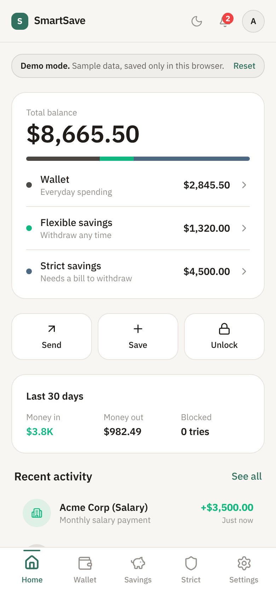
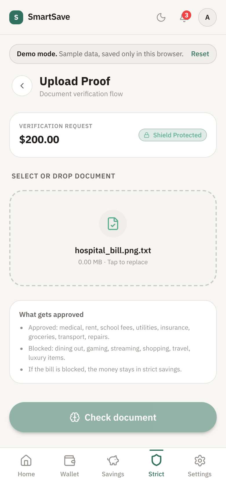
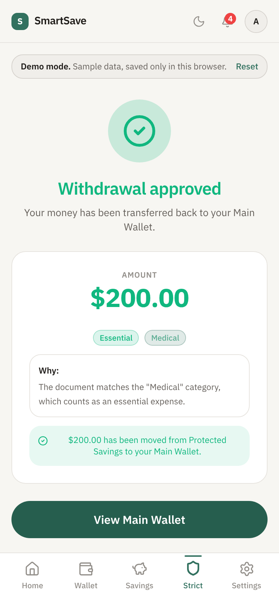
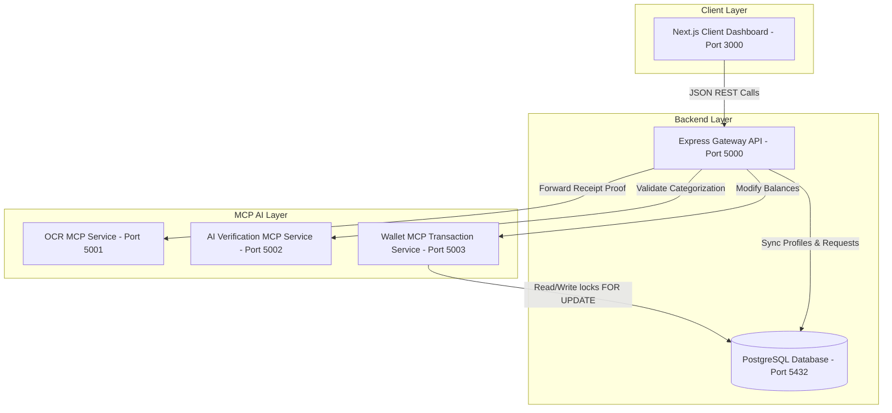

# SmartSave AI Wallet

A savings wallet where some of your money is locked. To take locked money out, you upload a bill. SmartSave reads it and only releases the money for essential expenses like medical bills, rent or school fees. Spending on gaming, shopping or eating out stays blocked.

**Status:** hackathon prototype built by a team. It is not a real bank and does not move real money.
<!-- TODO(Manikanta): add the hackathon name, team size and your own role, e.g.
## Team
Built at <hackathon> by a team of <N>. I built <your parts>.
-->

| Home | Bill check | Result |
|---|---|---|
|  |  |  |

## Try it in 1 minute (demo mode)

Demo mode runs the whole app in your browser. You do not need Clerk, Gemini, Python or a database.

```bash
npm install --prefix apps/web
npm run demo --prefix apps/web
```

Open http://localhost:3000, then:

1. Go to **Strict** and tap **Withdraw**. Enter an amount.
2. Upload `demo/hospital_bill.png.txt`. The withdrawal is approved and the money moves to your wallet.
3. Try again with `demo/gaming_invoice.png.txt`. The withdrawal is blocked and the money stays locked.
4. Tap **Reset** in the demo banner to start over.

To host the demo (for example on Vercel), deploy `apps/web` with the environment variable `NEXT_PUBLIC_DEMO_MODE=true`.

## What is real and what is simulated

| Part | Full setup | Demo mode |
|---|---|---|
| Login | Clerk (email, Google) | None (one sample account) |
| Balances and transfers | Express API + Wallet service + PostgreSQL | Same rules, stored in the browser |
| Reading the bill | Tesseract OCR for images, text layer for PDFs, `.txt` read directly | Reads `.txt` bills; for images it only uses the file name |
| Essential or not | Google Gemini, or keyword rules if no `GEMINI_API_KEY` | The same keyword rules, ported to TypeScript |
| Who decides | The server, right after the check. The app cannot approve its own withdrawal. | Same |

If the bill can't be read, the withdrawal is blocked. If the OCR or AI service is down, nothing is decided and no money moves.

## Known limitations

- No automated tests for the web app or the Express API yet. The Python services have a few unit tests (`pytest` in each `mcp/*` folder).
- Scanned PDFs without a text layer are not read yet.
- The keyword rules are simple: a bill is matched by words like "hospital" or "steam", not by understanding it. Gemini does better when a key is set.
- Balances are in USD and all money is test money.

## Architecture




### Services and ports

1. **Next.js Client**: Port `3000` (Next.js 15, Framer Motion, Tailwind CSS, Zustand, Clerk Authentication)
2. **Express Backend API**: Port `5000` (Node.js, TypeScript, Helmet, Rate Limiter, Swagger, Prisma ORM, Pino Logger)
3. **PostgreSQL Database**: Port `5432` (Prisma schema mapping tables)
4. **OCR MCP Server**: Port `5001` (Python, FastAPI, Tesseract OCR, OpenCV document preprocessor)
5. **AI Verification MCP Server**: Port `5002` (Python, FastAPI, Google Gemini API, exponential retry hooks)
6. **Wallet MCP Server**: Port `5003` (Python, FastAPI, psycopg2-binary, atomic row lock transactions)


## Full setup (real login, OCR and Gemini)

### Prerequisites
- Node.js v18+ & npm
- Python 3.10+
- PostgreSQL active server (or Docker Desktop)

### Environment Configuration
Copy the template at the repository root, then fill in your own keys:

```bash
cp .env.example server/.env
cp .env.example apps/web/.env.local
cp .env.example .env   # used by docker-compose
```

You need a free Clerk test account (publishable + secret key) and a Google Gemini API key. Never commit real keys.


### First run

```bash
npm install --prefix server && npm install --prefix apps/web
cd server && npx prisma db push && cd ..                          # create the tables
pip install -r mcp/ocr-server/requirements.txt -r mcp/ai-server/requirements.txt -r mcp/wallet-server/requirements.txt
```

Tesseract must be installed on your machine for image bills.

### Run locally

### Start all microservices in separate terminal splits (One Command)
If running directly on host OS without Docker, launch our unified launcher scripts:

#### Windows PowerShell:
```powershell
./start-dev.ps1
```

#### macOS / Linux:
```bash
chmod +x start-dev.sh
./start-dev.sh
```


### Docker Compose

To compile and launch the entire production stack inside a unified Docker container network:

```bash
# Build and boot all 6 service containers
docker-compose up --build
```

### Check that everything is running

`http://localhost:5000/health` lists the database and the three Python services. All four should say `UP`.

### API docs

The Express API serves Swagger docs at **[http://localhost:5000/api-docs](http://localhost:5000/api-docs)**
